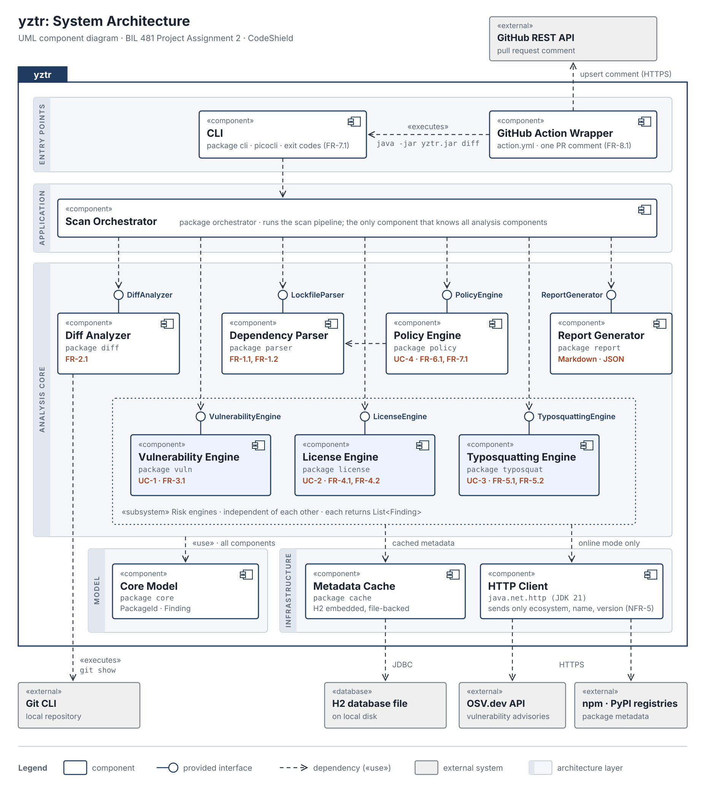

# 2. System Overview

## 2.1 Brief Project Description

yztr (Yazılım Tedarik Zinciri Risk Tarayıcısı, Software Supply Chain Risk Scanner) is a Java command-line tool and GitHub Action that reviews the dependency changes of a pull request. Code changes are reviewed in pull requests, but lockfile changes rarely are, so a single pull request can bring in a known vulnerability, a license the project cannot ship, or a look-alike of a popular package. yztr reads the dependency files at the base and head of the pull request (npm `package-lock.json`, PyPI `poetry.lock`, `uv.lock` and pinned `requirements.txt`, Maven through a CycloneDX SBOM), works out which packages were added, upgraded or downgraded, and checks only those packages.

Each changed package goes through three checks: known vulnerabilities from OSV.dev (UC-1), SPDX license compatibility with the project's license and distribution mode (UC-2), and typosquatting or non-existent package names on npm and PyPI (UC-3). A version-controlled policy file, `yztr-policy.yml`, sets the BLOCK and WARN thresholds and time-limited suppressions (UC-4). The result is one Markdown comment on the pull request, updated in place, and an exit code (0, 1 or 2) that lets CI block the merge. The goals are to combine the three checks in one free tool that also works on private repositories, to keep scans usable offline through a local cache, and to produce the same output for the same inputs.

## 2.2 System Architecture

yztr uses a **layered architecture**, and the scan itself runs as a **pipeline** driven by one orchestrator. It is not a client-server or microservice system: each run is a short-lived process on the developer's machine or on a GitHub-hosted runner. The Java code is a single Maven module packaged as one executable JAR, and each component in Figure 1 is a Java package under `tr.edu.etu.bil481.yztr`.

*Figure 1: UML component diagram of the yztr system architecture (source: [`diagrams/component-diagram.svg`](diagrams/component-diagram.svg)).*

| Layer | Component | Package | Responsibility | Requirements |
| --- | --- | --- | --- | --- |
| Entry points | GitHub Action Wrapper | `action.yml` | Runs `yztr diff` on every pull request and keeps a single report comment up to date | FR-8.1 |
| Entry points | CLI | `cli` | Parses commands and options, starts the scan, returns the exit code | FR-7.1 |
| Application | Scan Orchestrator | `orchestrator` | Runs the pipeline steps in order and collects the findings | — |
| Analysis core | Dependency Parser | `parser` | Reads lockfiles and SBOM files into package lists; shared JSON/YAML reading | FR-1.1, FR-1.2 |
| Analysis core | Diff Analyzer | `diff` | Reads the base and head files with `git show` and classifies each package as added, removed, upgraded, downgraded or unchanged | FR-2.1 |
| Analysis core | Vulnerability Engine | `vuln` | Matches package versions against OSV.dev advisories and merges CVE, GHSA and PYSEC identifiers | UC-1, FR-3.1 |
| Analysis core | License Engine | `license` | Normalizes licenses to SPDX and evaluates compatibility with the project license | UC-2, FR-4.1, FR-4.2 |
| Analysis core | Typosquatting Engine | `typosquat` | Compares names with the 15,000 most popular packages and flags names missing from the registry | UC-3, FR-5.1, FR-5.2 |
| Analysis core | Policy Engine | `policy` | Applies thresholds and suppressions from `yztr-policy.yml` and decides whether the scan blocks | UC-4, FR-6.1, FR-7.1 |
| Analysis core | Report Generator | `report` | Renders the findings as Markdown and JSON | FR-8.1, NFR-4 |
| Model | Core Model | `core` | Shared immutable data types such as `PackageId` and `Finding` | — |
| Infrastructure | Metadata Cache | `cache` | Stores OSV.dev responses and registry metadata in a file-backed H2 database | NFR-1 |
| Infrastructure | HTTP Client | JDK `java.net.http` | The only path to OSV.dev and the package registries | NFR-5 |

The architecture follows four rules:

- **Dependencies point downward.** A component may use components in its own layer or a lower layer, never a higher one. `core` depends on no other yztr package.
- **The risk engines are independent.** The vulnerability, license and typosquatting engines do not call each other. Each sits behind a small interface (for example `VulnerabilityEngine.evaluate(PackageId, boolean offlineMode)`) and returns a `List<Finding>`, so a new check can be added without changing the existing ones.
- **Only the orchestrator knows the whole pipeline.** The CLI contains no scanning logic, and the engines contain no policy or reporting logic.
- **Network and storage stay in the infrastructure layer.** In offline mode the engines use only the cache and make no network request. In tests, WireMock replaces OSV.dev and the registries, and a temporary H2 database replaces the cache.

A run of `yztr diff --base <ref> --head <ref>` passes through the components in this order:

1. The **CLI** parses the arguments and calls the **Scan Orchestrator**.
2. The **Diff Analyzer** reads the dependency files of both refs with `git show`, the **Dependency Parser** turns them into package lists, and the Diff Analyzer classifies the changed packages.
3. The **Vulnerability Engine** and **License Engine** evaluate every added, upgraded or downgraded package. The **Typosquatting Engine** evaluates every added npm or PyPI package.
4. The **Policy Engine** applies `yztr-policy.yml`: it marks findings that have an unexpired suppression and compares the remaining findings with the BLOCK and WARN thresholds.
5. The **Report Generator** writes the Markdown and JSON reports, and the CLI exits with 0 (no blocking finding), 1 (BLOCK threshold reached) or 2 (tool error).
6. In CI, the **GitHub Action Wrapper** posts the Markdown report as the pull request comment or updates the existing one.

## 2.3 Technology Stack

yztr has no web frontend and no server. Its user interfaces are the command-line output and the Markdown comment on the pull request.

| Area | Technology | Used for |
| --- | --- | --- |
| Language and runtime | Java 21 LTS | All application code |
| Build | Maven 3.9, maven-shade-plugin | Dependency management, tests, one executable JAR (`target/yztr.jar`) |
| CLI framework | picocli | Commands, options, help text, exit codes |
| JSON and YAML | Jackson (`jackson-databind`, `jackson-dataformat-yaml`) | Lockfiles, OSV.dev responses, the `yztr-policy.yml` policy file |
| Local database | H2, embedded and file-backed, through JDBC | Cache of OSV.dev responses and registry metadata; data for offline scans |
| HTTP | `java.net.http.HttpClient` from the JDK | Requests to OSV.dev and the package registries |
| External data sources | OSV.dev API, npm and PyPI registry APIs | Vulnerability advisories and package metadata |
| Version control integration | Git CLI (`git show`), GitHub Actions, GitHub REST API | Reading base and head files, running on pull requests, posting the report comment |
| Testing | JUnit 5, WireMock, JaCoCo | Unit tests, simulated OSV.dev and registry responses, coverage reports |
| Development environment | Eclipse with the Maven integration (m2e), GitHub | Coding, reviews, issue tracking |
